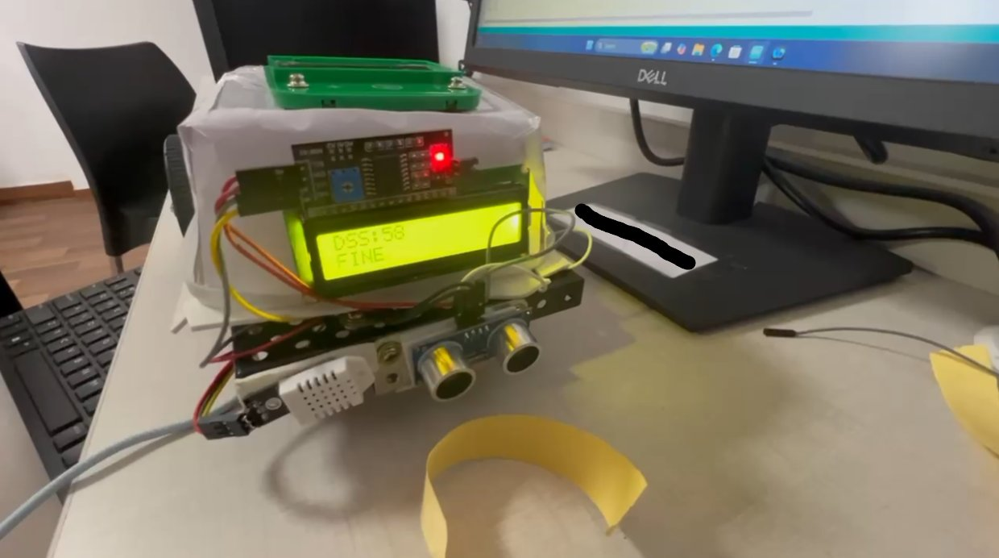
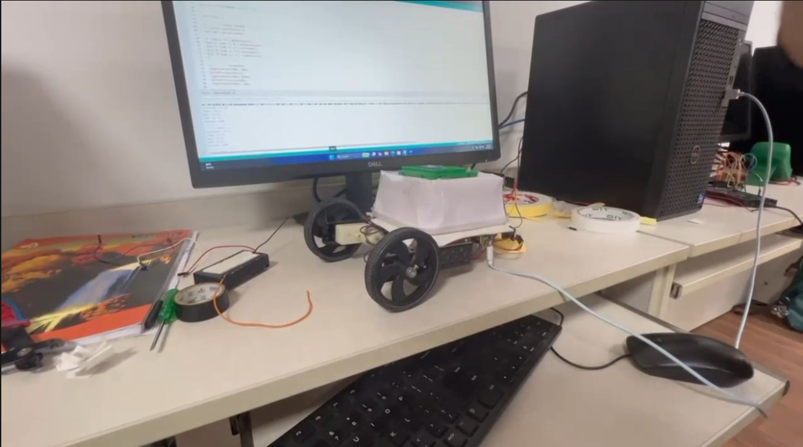

# AFDSA — Autonomous Field Deployment Suitability Analyzer

AFDSA is a mobile robotics project focused on assessing whether a location is suitable for placing precision field equipment. The prototype brings together a mobile chassis, onboard sensing, and a Deployment Suitability Score (DSS) concept to make terrain observations easier to collect and review.

## Prototype

The robot brings its electronics and display onto a mobile platform:



The wider view shows the chassis and how the electronics are mounted:



## Interface and sensor development

These screenshots show the project's web-control interface and sensor readings during development:


The screenshots document prototype work and may show features that are not in the current sketch.

## How the project works

The project is intended to collect motion and environmental observations while the robot moves through a survey area. These observations can be used to assess terrain stability and summarize conditions with a DSS.

The prototype imagery and development work show:

- A wheeled robot chassis with motorized movement
- An ESP32-based controller
- Motion and environmental sensor readings, including acceleration, temperature, and humidity
- A display and a browser-based movement-control interface

## Firmware in this repository

The current firmware is [`afdsa/afdsa.ino`](afdsa/afdsa.ino). It runs a basic web server on the ESP32 and provides browser controls for moving forward, backward, left, and right, and stopping the motors.

The checked-in sketch currently does **not** implement autonomous survey navigation, sensor readings, or DSS calculation. The screenshots above show prototype interfaces and development output; not every element shown is part of the current sketch.

### Try the firmware

1. Open `afdsa/afdsa.ino` in the Arduino IDE.
2. Select the ESP32 board and its connected serial port.
3. Set the Wi-Fi network name and password for your environment in the sketch.
4. Check that the motor driver and motor wiring match the GPIO assignments in the sketch before powering the robot.
5. Upload the sketch, open the Serial Monitor at **115200 baud**, and note the ESP32's IP address.
6. Open that IP address in a browser on the same Wi-Fi network to use the movement controls.

Only test motor controls in a clear, controlled area where the robot can move safely.

## Repository layout

```text
.
├── afdsa/
│   └── afdsa.ino
├── clips/
│   ├── robot-display.jpg
│   ├── robot-overview.jpg
│   ├── New Bitmap image.bmp
│   ├── New Bitmap image (2).bmp
│   ├── WhatsApp Image 2026-10-31 at 2.05.31 PM.jpeg
│   └── WhatsApp Image 2026-10-31 at 2.10.09 PM.jpeg
└── README.md
```

The original prototype photos and screenshots are kept in [`clips/`](clips/). The two JPEG photos embedded above are compact copies of the BMP photos for display in this README.

## Contributors

- Miraan Vahie
- Piyush Gupta
- Akshat Sharma

## License

All rights reserved. A design patent application is in process; no patent has been granted.
